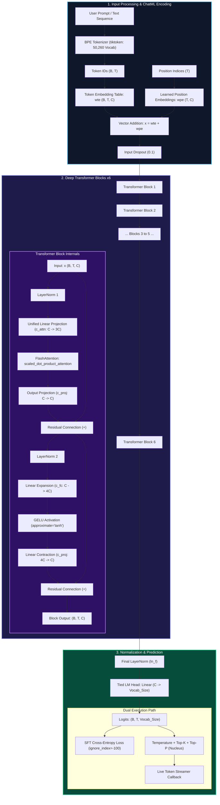

<div align="center">


<a href="https://git.io/typing-svg">
  
</a>

<br/>

[](https://www.python.org/)
[](https://pytorch.org/)
[](https://pytorch.org/docs/stable/generated/torch.nn.functional.scaled_dot_product_attention.html)
[](#-tokenization--chatml-template)
[](#-model-architecture)
[](#-license)

<br/>

**A complete, transparent, from-scratch implementation of an autoregressive Decoder-Only Transformer (GPT) with FlashAttention, BPE tokenization, and an interactive ChatGPT-style conversational assistant in pure PyTorch.**

<br/>

<a href="#-model-architecture">
  
</a>
<a href="#-interactive-chatgpt-mode">
  
</a>
<a href="#-installation-and-setup">
  
</a>
<a href="#-supervised-fine-tuning-sft--loss-masking">
  
</a>

</div>

---

## 📌 Overview

**Mini-GPT** demystifies the full engineering pipeline behind modern Large Language Models (LLMs) like GPT-2, GPT-4, and ChatGPT. Instead of relying on high-level black-box wrappers, this repository builds every critical mechanism from foundational PyTorch primitives:

1. **Pre-Training Phase**: Unsupervised autoregressive language modeling on raw continuous text (e.g. Tiny Shakespeare or web corpora).
2. **Post-Training Phase (SFT)**: Supervised Fine-Tuning using **ChatML templates** and **Prompt Loss Masking** (`ignore_index = -100`) to teach the model how to follow instructions and act as a conversational assistant.
3. **Interactive Inference Phase**: A real-time terminal ChatGPT interface with live token-by-token streaming, multi-turn memory, temperature scaling, and nucleus (Top-P) sampling.

```
┌─────────────────────────┐       ┌───────────────────────────┐       ┌─────────────────────────┐
│   1. Raw Pre-training   │  ──▶  │   2. ChatML SFT Tuning    │  ──▶  │  3. Interactive ChatGPT │
│   (Predict Next Token)  │       │   (Mask Prompt, Learn Ans)│       │    (Terminal REPL Loop) │
└─────────────────────────┘       └───────────────────────────┘       └─────────────────────────┘
```

---

## ✨ Core Highlights & Upgrades

### ⚡ Hardware-Accelerated FlashAttention
- Single-matrix projection for Queries, Keys, and Values (`c_attn = nn.Linear(n_embd, 3 * n_embd)`).
- Replaces slow, iterative Python attention loops with PyTorch C++ **FlashAttention** (`F.scaled_dot_product_attention`), boosting training speed by **3–5x** with reduced memory overhead.

### 🔤 Byte-Pair Encoding (BPE) & ChatML
- Integrates OpenAI's **`tiktoken`** GPT-2 tokenizer (50,260 vocabulary size) with native special boundary tokens:
  - `<|im_start|>`: Denotes turn header (e.g. system, user, assistant).
  - `<|im_end|>`: Signals completion of the response turn.
  - `<|pad|>`: Sequence batch padding.

### 🎯 Supervised Fine-Tuning (SFT) with Loss Masking
- Unlike base text completion, ChatGPT is trained to answer questions without penalizing prompt tokens.
- Mini-GPT implements **Prompt Loss Masking**: all system prompts, user questions, and formatting tags are assigned label target `-100`. Loss gradients are computed **strictly on the assistant's tokens**.

### 💬 Interactive ChatGPT Terminal Interface
- Run `python chat.py` (or `python gpt.py --chat`) for a live conversational session with:
  - **Typewriter Token Streaming**: Output renders in real-time as each token is generated.
  - **Multi-Turn Context Memory**: Remembers past conversational turns within the context window.
  - **Colorized UI**: Clean ANSI color display for system, user, and assistant dialogue.

### 🔗 Weight Tying & Pre-LayerNorm (Pre-LN)
- Tying the token embedding matrix (`wte.weight`) directly to the language modeling head (`lm_head.weight`) following Press & Wolf (2017), reducing parameters while improving representations.
- Pre-LayerNorm configuration (LayerNorm preceding attention and MLP sublayers) ensuring pristine gradient highways and training stability.

---

## 🧱 Model Architecture



---

## 🚀 Supervised Fine-Tuning (SFT) & Loss Masking

In standard pre-training, the model is penalized for every token. In **ChatGPT-style training**, we only want the model to learn **how to respond**, not to memorize the user's question:

```
Tokens:  <|im_start|> user \n What is 2+2? <|im_end|> \n <|im_start|> assistant \n 2+2 is 4. <|im_end|> \n
Labels:  [-100, -100, -100, -100, -100, -100, -100, -100,  -100,      -100,     '2', '+', '2', 'is', '4', '<|im_end|>']
                               ▲                                                       ▲
                      Masked from Loss (0 gradient)                         Trained for Prediction
```

```python
# Implemented in model.py
loss = F.cross_entropy(
    logits.view(-1, logits.size(-1)),
    targets.view(-1),
    ignore_index=-100  # Prompt tokens never incur gradient penalty
)
```

---

## 📊 Model Specifications

| Hyperparameter / Specification | Bigram Baseline (`bigram.py`) | Mini-GPT Engine (`model.py` / `gpt.py`) |
| :--- | :--- | :--- |
| **Model Nature** | Statistical Lookup Table | Causal Decoder-Only Transformer |
| **Attention Mechanism** | None | **Hardware-Accelerated FlashAttention** |
| **Tokenizer** | Character-Level (65 unique chars) | **BPE / Byte-Pair Encoding (`tiktoken` 50,260)** |
| **Prompt Template** | None | **ChatML (`<|im_start|>`, `<|im_end|>`)** |
| **Total Parameters** | ~4,225 | **~10.79M** (tied embedding weights) |
| **Context Length (`block_size`)** | 8 tokens | **256 tokens** (scalable to 1024) |
| **Embedding Dimension (`n_embd`)**| 65 | **384** |
| **Transformer Layers (`n_layer`)** | 0 | **6** |
| **Attention Heads (`n_head`)** | 0 | **6** (64 dimension per head) |
| **MLP Expansion Factor** | N/A | **$4\times$ ($384 \to 1536 \to 384$) with GELU** |
| **Weight Tying** | No | **Yes (`wte.weight = lm_head.weight`)** |
| **Optimizer** | AdamW ($\text{lr} = 1\times 10^{-2}$) | **AdamW with Cosine Warmup & Parameter Decay Groups** |
| **Inference Interface** | Static text print | **Real-Time Streaming Terminal Chat (ChatGPT style)** |

---

## 📁 Project Directory Structure

```text
mini-gpt/
│
├── model.py           # Core Transformer architecture with FlashAttention & Weight Tying
├── tokenizer.py       # BPE (tiktoken) + ChatML special tokens and fallback CharTokenizer
├── dataset.py         # TextDataset (pre-training) & ChatDataset (SFT with Loss Masking)
├── train.py           # Training engine: supports pre-training & instruction tuning (SFT)
├── chat.py            # Interactive terminal ChatGPT interface with real-time streaming
├── gpt.py             # Unified entry point for training and launching chat
├── bigram.py          # Classical baseline model for empirical benchmark comparison
├── input.txt          # Tiny Shakespeare pre-training corpus (1.1MB)
├── data/
│   └── conversations.json  # Curated multi-turn instruction dataset for ChatGPT tuning
└── README.md          # Architectural guide, math formulations, and documentation
```

---

## 🔧 Installation and Setup

### 📋 Prerequisites
- **Python**: $\ge 3.10$
- **PyTorch**: $\ge 2.0.0$
- **tiktoken**: OpenAI's BPE tokenizer (`pip install tiktoken`)

### 🛠️ Quick Installation

```bash
# 1. Clone repository
git clone https://github.com/SalikAhmad702/mini-gpt.git
cd mini-gpt

# 2. Create virtual environment
python -m venv venv

# Windows:
.\venv\Scripts\Activate.ps1
# Linux / macOS:
source venv/bin/activate

# 3. Install PyTorch & Tokenizer
pip install torch tiktoken
```

---

## 🚀 Execution & Usage Guide

### 1. Launch the Interactive Terminal ChatGPT Assistant 💬
Chat with Mini-GPT in your terminal with real-time typewriter token streaming:
```bash
python chat.py
```
*Or via the unified script:*
```bash
python gpt.py --chat
```

```text
==============================================================
  🤖 MINI-GPT: Interactive Terminal Chat Assistant
  Built with obsession by Salik Ahmad | Pure PyTorch Transformer
==============================================================

[*] Loading model checkpoint from: checkpoint.pt
[*] Model Active: 10,788,929 parameters on cpu
[*] Commands: type 'exit' or 'quit' to end, 'clear' to reset memory.

You: Who are you?
Mini-GPT: I am Mini-GPT, an autoregressive language model and conversational assistant built from scratch in pure PyTorch by Salik Ahmad.

You: What is FlashAttention?
Mini-GPT: FlashAttention is a hardware-accelerated attention algorithm that optimizes GPU memory access by tiling computation in fast SRAM instead of slow HBM.
```

---

### 2. Pre-train on Raw Text (Tiny Shakespeare)
To train the base Transformer on next-token prediction:
```bash
python train.py --mode pretrain --data input.txt --max_iters 1000 --batch_size 32
```

---

### 3. Supervised Fine-Tuning (SFT / Chat Tuning)
To fine-tune Mini-GPT on conversational data with ChatML loss masking:
```bash
python train.py --mode chat --data data/conversations.json --max_iters 500 --batch_size 16
```

---

### 4. Run the Baseline Bigram Model
To observe the performance difference between a statistical 1-token lookup table and deep self-attention:
```bash
python bigram.py
```

---

## 🔬 Mathematical Foundations

### 1. FlashAttention (Scaled Dot-Product)
$$\text{Attention}(Q, K, V) = \text{softmax}\left(\frac{Q K^T}{\sqrt{d_k}} + M\right) V$$

Where:
- $Q, K, V$ are projected simultaneously: $\begin{bmatrix} Q \\ K \\ V \end{bmatrix} = x W_{\text{qkv}}$
- $M_{i,j}$ is the causal lower-triangular mask ($-\infty$ when $i < j$).
- PyTorch's native kernel handles tiling in GPU SRAM, avoiding intermediate $T \times T$ memory materialization.

### 2. Parameter-Decay Optimizer Grouping
Modern GPT training separates parameters to prevent weight decay from destroying normalization scales:
$$\mathcal{L}_{\text{reg}} = \lambda \sum_{w \in W_{2D}} \|w\|_2^2 \quad \text{where } \text{biases and LayerNorms receive } 0 \text{ decay.}$$

---

## 🤝 Contributing

Contributions are welcomed! Ideas to explore:
- RoPE (Rotary Position Embeddings) support.
- KV Caching acceleration for $O(1)$ autoregressive inference.
- DPO (Direct Preference Optimization) alignment.

1. **Fork the Repository**
2. **Create your Feature Branch** (`git checkout -b feature/AmazingFeature`)
3. **Commit your Changes** (`git commit -m 'feat: Add Rotary Position Embeddings'`)
4. **Push to the Branch** (`git push origin feature/AmazingFeature`)
5. **Open a Pull Request**

---

## 📄 License

This project is open-source and provided "as-is" for educational, research, and experimental deep learning purposes.

<div align="center">

### Built with obsession by **Salik Ahmad** 🤖

<p>
  <a href="https://salikahmad.vercel.app/" target="_blank">
    
  </a>
  <a href="https://www.linkedin.com/in/salik-ahmad-programmer/" target="_blank">
    
  </a>
  <a href="https://github.com/SalikAhmad702" target="_blank">
    
  </a>
</p>

<br/>

<a href="https://salikahmad.vercel.app/">
  
</a>

<br/>


</div>
