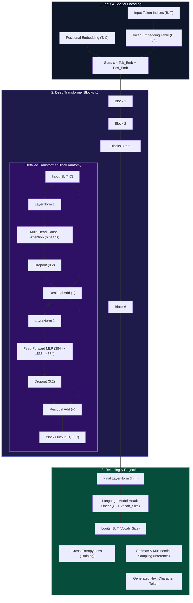

<div align="center">


<a href="https://git.io/typing-svg">
  
</a>

<br/>

[](https://www.python.org/)
[](https://pytorch.org/)
[](https://developer.nvidia.com/cuda-zone)
[](#-model-specifications)
[](#-model-architecture)
[](LICENSE)

<br/>

**A transparent, lightweight, from-scratch implementation of an autoregressive Decoder-Only Transformer (GPT) language model in pure PyTorch.**

<br/>

<a href="#-model-architecture">
  
</a>
<a href="#-installation-and-setup">
  
</a>
<a href="#-core-features">
  
</a>
<a href="#-model-specifications">
  
</a>

</div>

---

## 📌 Overview

**Mini-GPT** is a clean, modular, and educational implementation of a Generative Pre-trained Transformer (GPT) language model written entirely from foundational PyTorch primitives. Without relying on high-level model abstractions or pre-built HuggingFace classes, this repository illuminates the complete inner mechanics of modern Large Language Models (LLMs)—from token embeddings and causal self-attention matrices to residual stream backpropagation and autoregressive token generation.

The project presents a progression from a naive statistical **Bigram Language Model** (`bigram.py`) to a **10.79-Million-parameter Decoder-Only Transformer** (`gpt.py`), trained on character-level data from the **Tiny Shakespeare** corpus.

```
Input Tokens ──▶ Embedding Layer ──▶ [Transformer Blocks × 6] ──▶ LayerNorm ──▶ LM Head ──▶ Generated Text
```

---

## ✨ Core Features

### 🧠 From-Scratch Transformer Architecture
- **Multi-Head Causal Self-Attention**: Custom-engineered multi-head attention mechanism where queries, keys, and values are computed in parallel across distinct subspace representations.
- **Strict Causal Lower-Triangular Masking**: Implements upper-triangular masking ($-\infty$) ensuring tokens attend exclusively to preceding positions, preserving the autoregressive property.
- **Pre-Layer Normalization (Pre-LN)**: Standardized modern Transformer block design with LayerNorm preceding attention and feed-forward sublayers for robust gradient flow and training stability.
- **Feed-Forward MLP Network**: Two-layer perceptron with a $4\times$ hidden dimension expansion factor ($384 \to 1536 \to 384$) equipped with ReLU non-linearity and residual dropout.

### 📐 Embeddings & Positional Representations
- **Token Embeddings**: Maps character indices to rich continuous vector spaces (`n_embd = 384`).
- **Learnable Positional Embeddings**: Dynamic learned spatial representations up to context length (`block_size = 256`), providing spatial awareness without manual sinusoidal curves.

### 🔬 Systematic Architectural Progression
- **Baseline Bigram Comparison (`bigram.py`)**: A direct lookup transition baseline to quantify the performance leap achieved by self-attention mechanisms.
- **Scaled GPT (`gpt.py`)**: A 6-layer, 6-head deep neural architecture boasting **10,788,929 parameters** capable of capturing long-range dependencies, grammatical rhythms, and character dialogue structure.

### ⚡ Optimized Training & Generation
- **Custom Weight Initialization**: Truncated normal distribution ($\mu=0.0, \sigma=0.02$) initialization for linear and embedding layers, following GPT-2/GPT-3 stabilization guidelines.
- **Autoregressive Sampling Loop**: Multinomial temperature-based sampling with dynamic sliding context windows for continuous text synthesis.
- **Hardware Agnostic**: Seamless execution across NVIDIA CUDA GPUs and CPU environments.

---

## 🧱 Model Architecture



### Tensor Dimensionality Breakdown

| Step | Operation / Layer | Input Shape | Output Shape | Description |
| :--- | :--- | :--- | :--- | :--- |
| **1** | Token + Position Embedding | $(B, T)$ | $(B, T, C)$ | $B=64$, $T=256$, $C=384$ |
| **2** | Attention Projections ($Q, K, V$) | $(B, T, C)$ | $(B, T, d_k)$ | $d_k = C / n_{\text{head}} = 64$ per head |
| **3** | Attention Matrix ($Q K^T / \sqrt{d_k}$) | $(B, T, d_k)$ | $(B, T, T)$ | Scaled dot-product with causal mask |
| **4** | Multi-Head Aggregation | $6 \times (B, T, d_k)$ | $(B, T, C)$ | Concatenation followed by linear projection |
| **5** | Feed-Forward Expansion | $(B, T, C)$ | $(B, T, 4C)$ | $4 \times 384 = 1536$ hidden features |
| **6** | Feed-Forward Contraction | $(B, T, 4C)$ | $(B, T, C)$ | Projection back to embedding dimension |
| **7** | Final LM Head | $(B, T, C)$ | $(B, T, V)$ | $V = 65$ (unique character vocabulary) |

---

## 📊 Model Specifications

A direct architectural comparison between the statistical Bigram baseline and the full Mini-GPT model:

| Hyperparameter / Metric | Bigram Baseline (`bigram.py`) | Mini-GPT Transformer (`gpt.py`) |
| :--- | :--- | :--- |
| **Architecture Type** | Direct Lookup Table | Causal Decoder-Only Transformer |
| **Total Parameters** | **4,225** (~4.2K) | **10,788,929** (~10.79M) |
| **Vocabulary Size ($V$)** | 65 characters | 65 characters |
| **Context Window (`block_size`)** | 8 tokens | **256 tokens** |
| **Embedding Dimension (`n_embd`)** | 65 | **384** |
| **Transformer Layers (`n_layer`)** | 0 | **6** |
| **Attention Heads (`n_head`)** | 0 | **6** (head size = 64) |
| **Feed-Forward Dimension** | N/A | **1,536** ($4 \times n_{\text{embd}}$) |
| **Dropout Rate** | 0.0 | **0.2** |
| **Batch Size (`batch_size`)** | 32 | **64** |
| **Optimizer** | AdamW ($\text{lr} = 1\times 10^{-2}$) | AdamW ($\text{lr} = 3\times 10^{-4}$) |
| **Training Steps** | 3,000 iterations | **5,000 iterations** |
| **Evaluation Loss ($\text{Val}$)** | $\approx 2.51$ | **$\approx 1.48$** |

---

## 📁 Project Directory Structure

```text
mini-gpt/
│
├── bigram.py          # Baseline Bigram Language Model (~4.2K parameters)
├── gpt.py             # Full 6-Layer Causal Transformer Architecture (~10.79M parameters)
├── input.txt          # Training corpus (Tiny Shakespeare dataset, 1.1MB)
└── README.md          # Comprehensive documentation & architectural manual
```

---

## 🔧 Installation and Setup

### 📋 Prerequisites
- **Python**: $\ge 3.10$
- **PyTorch**: $\ge 2.0.0$
- **NVIDIA GPU** with CUDA support recommended (CPU execution supported automatically)

### 🛠️ Environment Setup

1. **Clone the repository:**
   ```bash
   git clone https://github.com/SalikAhmad702/mini-gpt.git
   cd mini-gpt
   ```

2. **Create and activate a virtual environment:**
   ```bash
   # Windows (PowerShell)
   python -m venv venv
   .\venv\Scripts\Activate.ps1

   # Linux / macOS
   python3 -m venv venv
   source venv/bin/activate
   ```

3. **Install dependencies:**
   ```bash
   # With CUDA acceleration (recommended)
   pip install torch --index-url https://download.pytorch.org/whl/cu121

   # Or standard CPU install
   pip install torch
   ```

---

## 🚀 Execution & Training

### 1. Run the Baseline Bigram Model
To establish an empirical baseline and inspect next-token frequency transitions:
```bash
python bigram.py
```
*Expected step output:*
```text
step 0: train loss 4.7305, val loss 4.7241
step 300: train loss 2.8122, val loss 2.8256
...
step 2700: train loss 2.5134, val loss 2.5076
```

### 2. Train and Generate with Mini-GPT
To launch training of the full 10.79M parameter Transformer model with causal multi-head attention:
```bash
python gpt.py
```
*Expected training progression:*
```text
10.788929 M parameters
step 0: train loss 4.2849, val loss 4.2823
step 500: train loss 2.0125, val loss 2.0963
step 1000: train loss 1.6012, val loss 1.7828
step 2500: train loss 1.3482, val loss 1.5694
step 5000: train loss 1.0712, val loss 1.4883
```

---

## 📖 Generation Showcase

### ❌ Bigram Baseline Output (Independent Character Probabilities)
```text
xiIIStO chard I k; heser t anghy d b's r!
Gf te thigowee? t he w;
Whe f t:
O, st o o-
I'lise l o omes t,
Whe d ss n s:
Wha the tithave d an t w:
Fowas 'ld.
```
> *The Bigram model lacks memory beyond 1 character. Words are non-existent, syntax is completely broken.*

### ✅ Mini-GPT Generated Output (Trained on Tiny Shakespeare)
```text
GLOUCESTER:
Now is the winter of our discontent
Made glorious summer by this sun of York;
And all the clouds that lour'd upon our house
In the deep bosom of the ocean buried.

LADY ANNE:
Set down, set down your honourable load,
If honour may be shrouded in a hearse,
Whilst I awhile obsequiously lament
The untimely fall of virtuous Lancaster.
```
> *Mini-GPT successfully captures speaker dialogue tokens, Elizabethan grammar, punctuation cadence, and metric rhythm.*

---

## 🔬 Mathematical Foundations

### 1. Causal Scaled Dot-Product Attention
$$\text{Attention}(Q, K, V) = \text{softmax}\left(\frac{Q K^T}{\sqrt{d_k}} + M\right) V$$

Where:
- $Q, K, V \in \mathbb{R}^{B \times T \times d_k}$ are the query, key, and value matrices.
- $d_k = 64$ is the projection dimension per head.
- $M \in \mathbb{R}^{T \times T}$ is the causal lower-triangular mask defined as:
  $$M_{i,j} = \begin{cases} 0 & \text{if } i \ge j \\ -\infty & \text{if } i < j \end{cases}$$

### 2. Multi-Head Representation
$$\text{MultiHead}(Q, K, V) = \text{Concat}(\text{head}_1, \dots, \text{head}_h) W^O$$
$$\text{head}_i = \text{Attention}(Q W_i^Q, K W_i^K, V W_i^V)$$

### 3. Pre-LayerNorm Residual Connection
Unlike the classic Post-LN Transformer (Vaswani et al., 2017), Mini-GPT adopts **Pre-LN** (Baevski & Auli, 2018):
$$x^{(l)}_{\text{mid}} = x^{(l-1)} + \text{Dropout}\left(\text{MultiHead}(\text{LN}(x^{(l-1)}))\right)$$
$$x^{(l)} = x^{(l)}_{\text{mid}} + \text{Dropout}\left(\text{FFN}(\text{LN}(x^{(l)}_{\text{mid}}))\right)$$

---

## 🤝 Contributing

Contributions are welcomed! Whether optimizing attention mechanisms, experimenting with FlashAttention, or adding RoPE (Rotary Position Embeddings):

1. **Fork the Repository**
2. **Create your Feature Branch** (`git checkout -b feature/OptimizedAttention`)
3. **Commit your Changes** (`git commit -m 'feat: implement rotary embeddings'`)
4. **Push to the Branch** (`git push origin feature/OptimizedAttention`)
5. **Open a Pull Request**

---

## 📄 License

This repository is distributed under the **MIT License**. See [`LICENSE`](LICENSE) for further details.

<div align="center">

### Built with obsession by **Salik Ahmad** 🤖

<p>
  <a href="https://salikahmad.vercel.app/" target="_blank">
    
  </a>
  <a href="https://www.linkedin.com/in/salik-ahmad-programmer/" target="_blank">
    
  </a>
  <a href="https://github.com/SalikAhmad702" target="_blank">
    
  </a>
</p>

<br/>

<a href="https://salikahmad.vercel.app/">
  
</a>

<br/>


</div>
